# DriverGuard Lite: Real-Time Driver Behavior Monitoring

A webcam-based driver monitoring system built on YOLO11n that detects drowsiness, phone use, smoking and distraction in real time, raises duration-based alarms, and logs every event. Optimized with OpenVINO INT8 to run at camera speed on a low-power laptop CPU.

> Demo video: _coming soon_

## Highlights
- **0.930 mAP50** on the held-out test set across 8 driver-behavior classes (YOLO11n, 5.3 MB).
- **~5x faster CPU inference** with OpenVINO: 85 ms → ~16 ms per frame on an Intel Core 5 120U (PyTorch vs. OpenVINO FP32/FP16).
- **INT8 quantization:** 3.2 MB model (vs. 10.3 MB FP32) with no accuracy loss (mAP50 0.929 vs. 0.927 FP32).
- **Duration-based alarms:** an alarm fires only when a risky behavior persists for ≥ 2 s, which suppresses blink and single-frame false alarms.
- **Real-world testing with honest failure analysis:** a viewpoint/domain-shift failure on `Distracted` and a false positive on `PhoneUse` are documented below.

## How it works

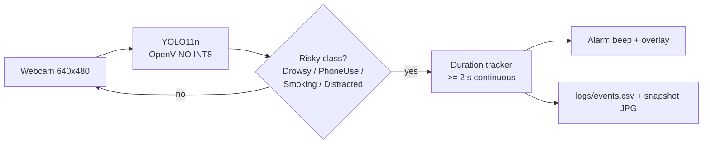

- Alarms are raised only for `Drowsy`, `PhoneUse`, `Smoking` and `Distracted`, and only when the behavior is detected continuously for ≥ 2 seconds (`--alarm-seconds`, default 2). Detections that disappear for < 0.5 s are treated as the same event.
- Each event is written to `logs/events.csv` (`start_time, end_time, duration_s, behavior, max_conf, snapshot`) together with one snapshot JPG.
- The alarm beep runs in a separate thread (Windows); the window overlays FPS and per-frame model time.

## Dataset
[Driver Monitoring System](https://universe.roboflow.com/driver-monitoring-system-woxvc/driver-monitoring-system-v0mei/dataset/11) (Roboflow Universe, workspace `driver-monitoring-system-woxvc`, version 11, CC BY 4.0).

| Split | Images |
|---|---|
| Train | 29,064 (includes ~3x Roboflow augmentation) |
| Valid | 2,053 |
| Test | 1,952 |

8 classes. Training-set box counts:

| Class | Boxes |
|---|---|
| SafeDriving | 24,996 |
| Seatbelt | 8,841 |
| Smoking | 8,421 |
| PhoneUse | 6,195 |
| Drowsy | 4,539 |
| Drinking | 1,779 |
| Distracted | 1,725 |
| Eating | 1,020 |

**Data findings**
- Strong class imbalance: `SafeDriving` has ~25x more boxes than `Eating`.
- An older version (v8, 3,512 images) had 15 classes with duplicated labels (e.g. `awake` vs. `Normal_Driving`) and only 136 `Drowsy` boxes, so I switched to the cleaned v11.
- `SafeDriving` and `Drowsy` boxes mark the **eyes** (open vs. closed), not the whole face.

## Training
- Model: YOLO11n (Ultralytics), pretrained on COCO (transfer learning)
- 30 epochs, `imgsz` 640, batch 16, patience 10
- Google Colab, Tesla T4 GPU, 3.32 h total (~6–7 min/epoch)
- Validation mAP50 went from 0.750 at epoch 1 to a plateau of 0.926–0.931 from ~epoch 18
- Best validation: mAP50 0.931, mAP50-95 0.710, P 0.924, R 0.883
- Notebook: [`notebooks/DriverGuard_Lite_Training.ipynb`](notebooks/DriverGuard_Lite_Training.ipynb)

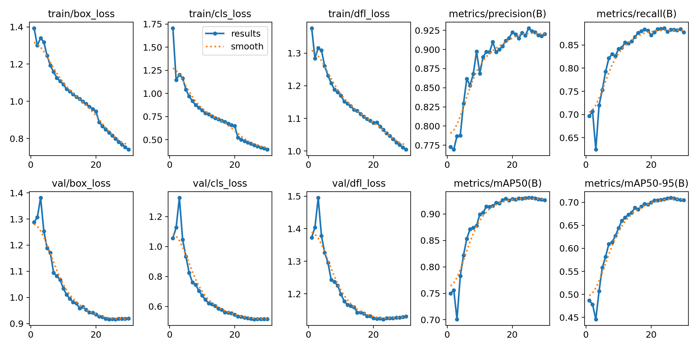

## Evaluation (test set, `best.pt`)

Overall: **P 0.912 | R 0.891 | mAP50 0.930 | mAP50-95 0.709**

| Class | P | R | mAP50 | mAP50-95 |
|---|---|---|---|---|
| Distracted | 0.967 | 0.932 | 0.975 | 0.855 |
| Drinking | 0.852 | 0.897 | 0.906 | 0.662 |
| Drowsy | 0.824 | 0.789 | 0.880 | 0.680 |
| Eating | 0.951 | 0.943 | 0.946 | 0.749 |
| PhoneUse | 0.953 | 0.920 | 0.958 | 0.732 |
| SafeDriving | 0.929 | 0.952 | 0.980 | 0.793 |
| Seatbelt | 0.895 | 0.805 | 0.857 | 0.612 |
| Smoking | 0.929 | 0.893 | 0.938 | 0.591 |

`Drowsy`, the most safety-critical class, has recall 0.789, slightly below my 0.80 target. `Drinking` scored 0.860 mAP50 on validation but 0.906 on test; with small sample sizes, conclusions from a single split should be treated carefully.

| Confusion matrix | Normalized |
|---|---|
| 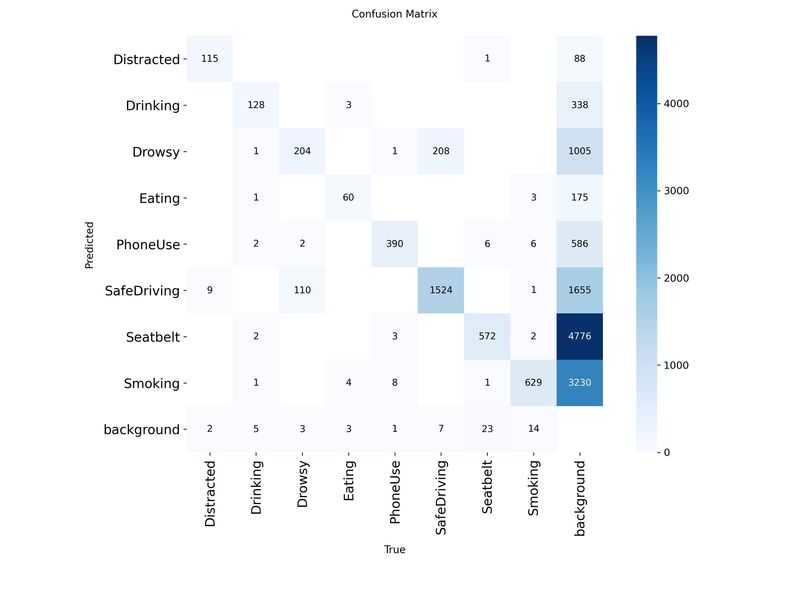 | 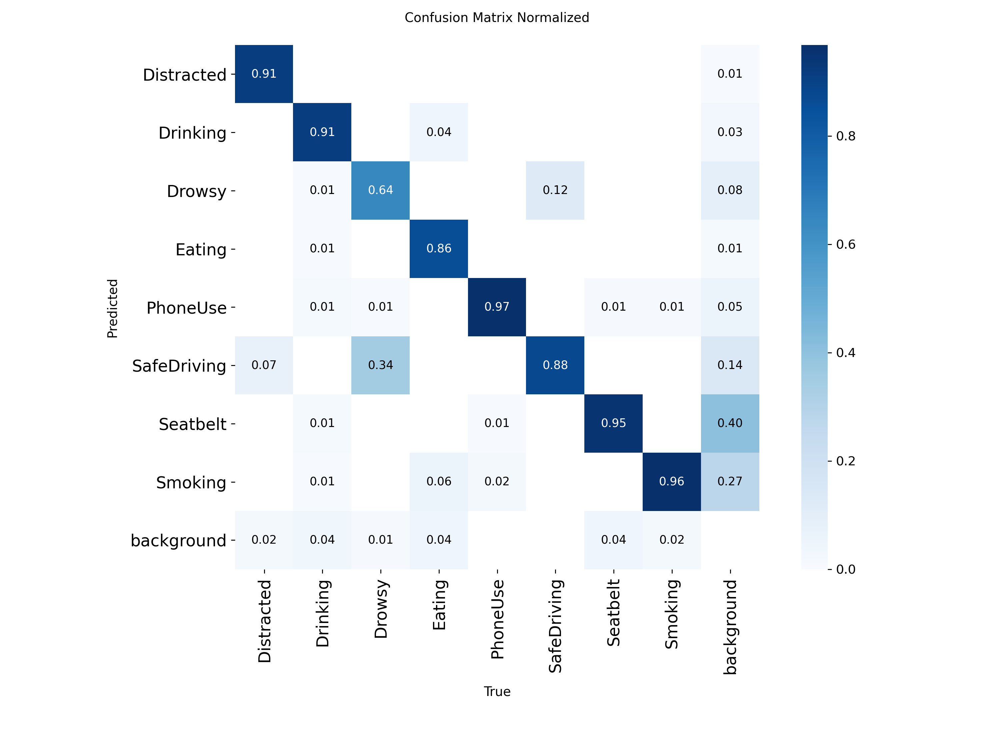 |

## Optimization & Benchmark

Models were exported to OpenVINO in Colab; accuracy was measured on the test set.

| Format | mAP50 | mAP50-95 | Drowsy AP50 | Size | Colab CPU (Xeon 2.0 GHz) |
|---|---|---|---|---|---|
| PyTorch | 0.930 | 0.709 | 0.880 | 5.3 MB | – |
| OpenVINO FP32 | 0.927 | 0.704 | 0.875 | 10.3 MB | 84.0 ms |
| OpenVINO FP16 | 0.927 | 0.704 | 0.875 | 5.4 MB | 83.0 ms |
| OpenVINO INT8 (NNCF, calibrated on the 2,053 val images) | 0.929 | 0.704 | 0.877 | 3.2 MB | 66.9 ms |

**On the target device** (Intel Core 5 120U, a low-power U-series CPU used as an edge-device proxy; Fantech Luminous C30 webcam, 640x480). "Model" = preprocess + inference + postprocess.

| Format | Model time | Display FPS |
|---|---|---|
| PyTorch | 85 ms | 14 |
| OpenVINO FP32 | 17 ms | 20 |
| OpenVINO FP16 | 16 ms | 20 |
| OpenVINO INT8 | 11–17 ms | 20 |

| PyTorch (85 ms, 14 FPS) | OpenVINO FP32 (17 ms, 20 FPS) | OpenVINO FP16 (16 ms, 20 FPS) |
|---|---|---|
| 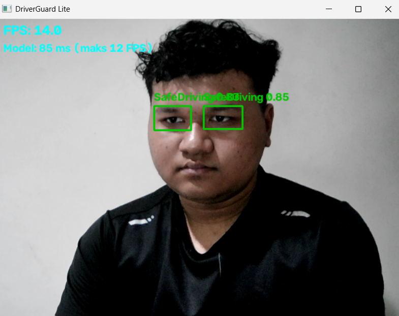 | 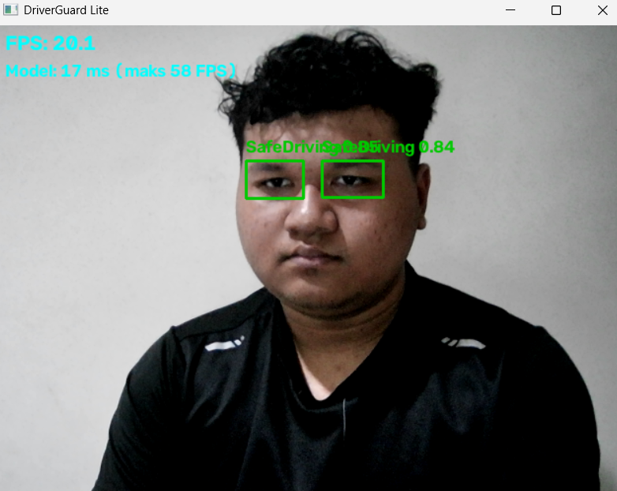 | 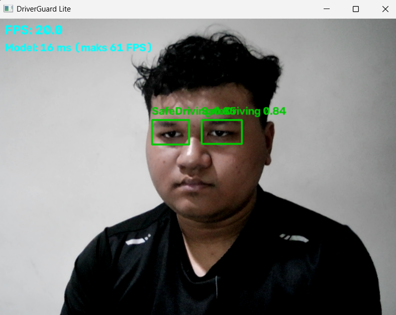 |

The INT8 model was not benchmarked with a separate screenshot: all functional test screenshots below (bright and dim) were run with the INT8 model and show 12–16 ms model time at ~20 FPS.

**Interpretation**
- OpenVINO is ~5x faster than PyTorch (85 → ~16 ms). After optimization, the bottleneck moves to the camera (~20 FPS); the model uses only about a third of each frame's time budget.
- FP16 does not speed up inference on CPU (the CPU still computes in FP32); it only shrinks the file.
- On this CPU, INT8 is not much faster than FP32/FP16 (the model is already tiny and pre/postprocessing is not accelerated). Its main benefit is a 3x smaller model with no accuracy loss. On the Colab CPU, INT8 is ~20% faster.
- **INT8 was chosen as the deployment model.**
- Early observation, "profile before you optimize": with the laptop's built-in webcam, FPS was stuck at ~10 because of the camera, not the model (YOLO11n COCO: PyTorch 104 ms vs. OpenVINO FP32 20 ms).

## Real-world webcam testing

Tested with the INT8 model, a frontal camera and myself as the subject.

### Bright lighting

| | |
|---|---|
| 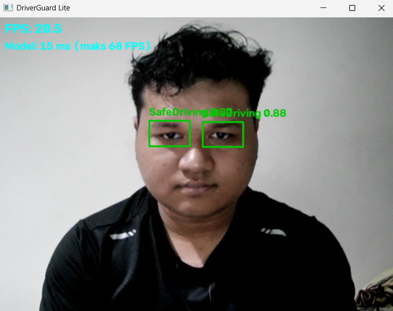 | 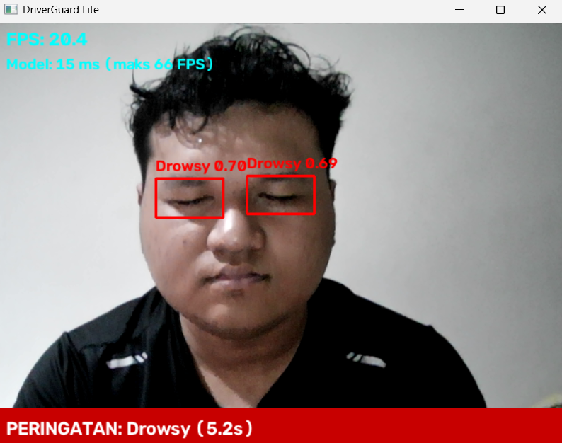 |
| **SafeDriving** (eyes open): 0.83–0.89 | **Drowsy** (eyes closed): 0.69–0.70, alarm triggered |
| 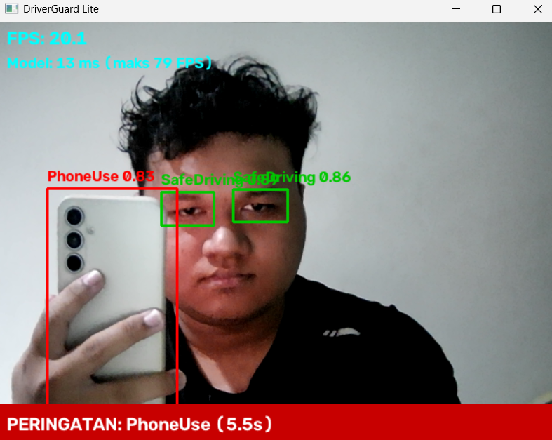 | 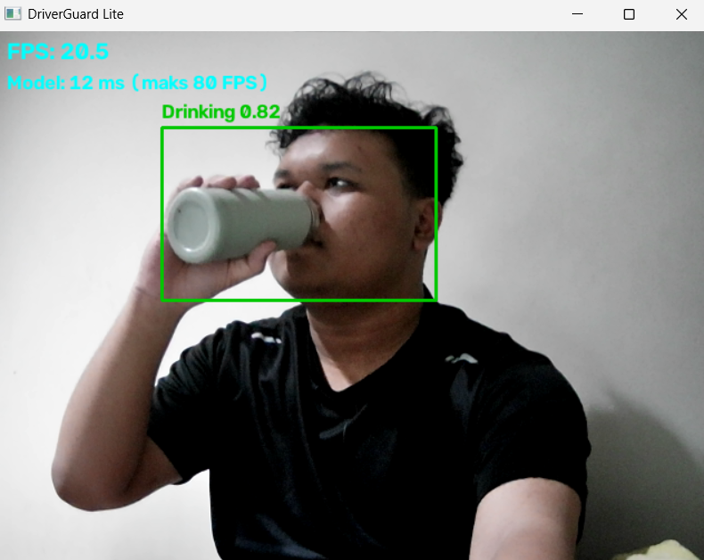 |
| **PhoneUse** with a real phone: 0.83, alarm triggered | **Drinking** from a bottle: 0.82, no alarm (by design) |
| 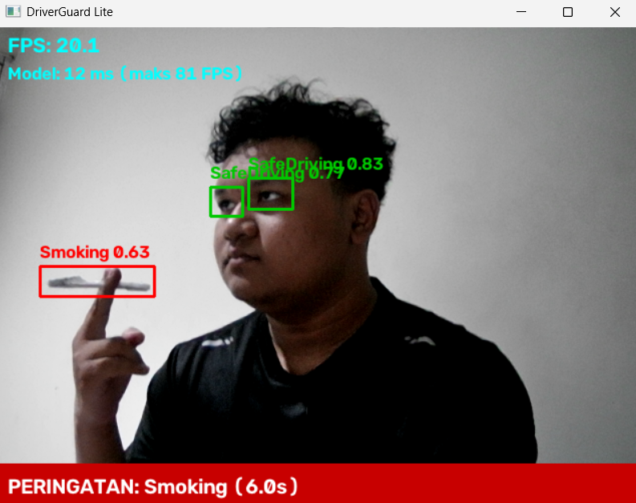 | 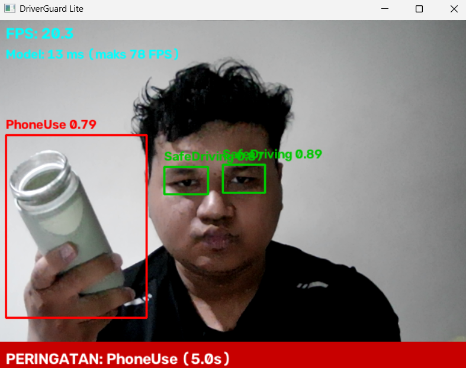 |
| **Smoking** with a pen as a cigarette stand-in: 0.63, alarm triggered (a proxy; technically also a false positive) | **False positive:** a bottle held beside the face detected as `PhoneUse` 0.79 and triggered an alarm |

Turning the head left/right was **not** detected as `Distracted`.

### Dim lighting (room lights partly off)

| | |
|---|---|
| 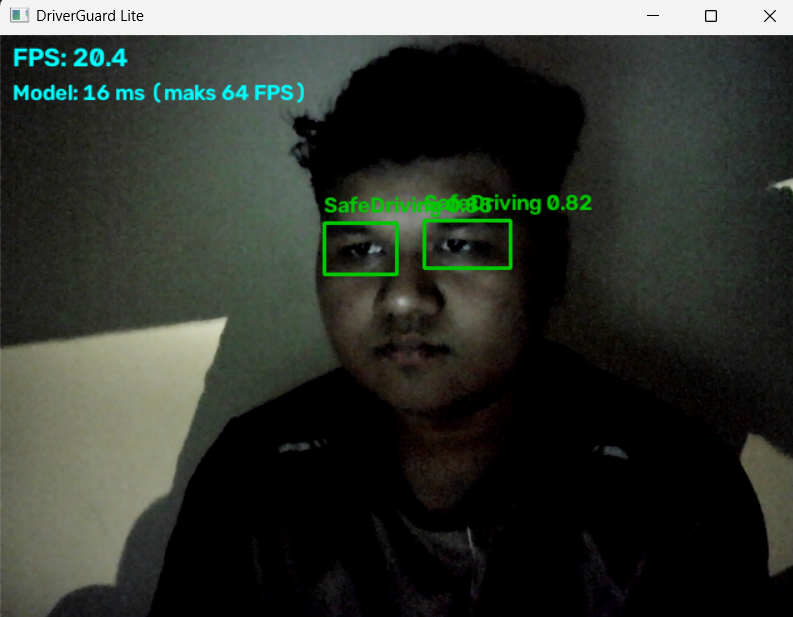 | 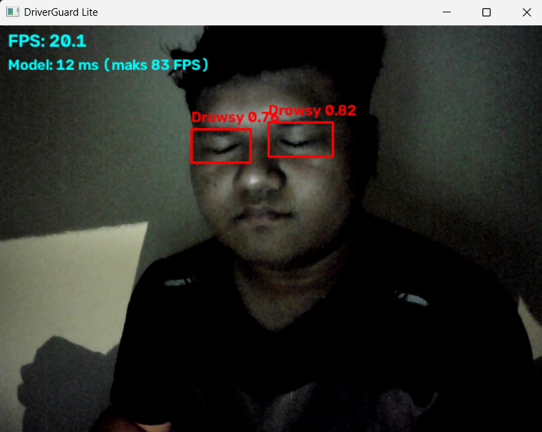 |
| **SafeDriving** 0.73–0.82 | **Drowsy** 0.76–0.82 |
| 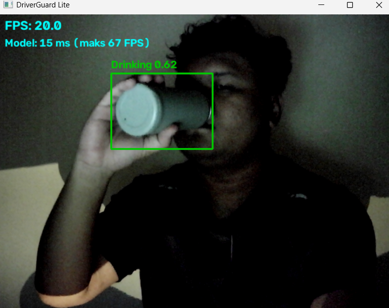 | 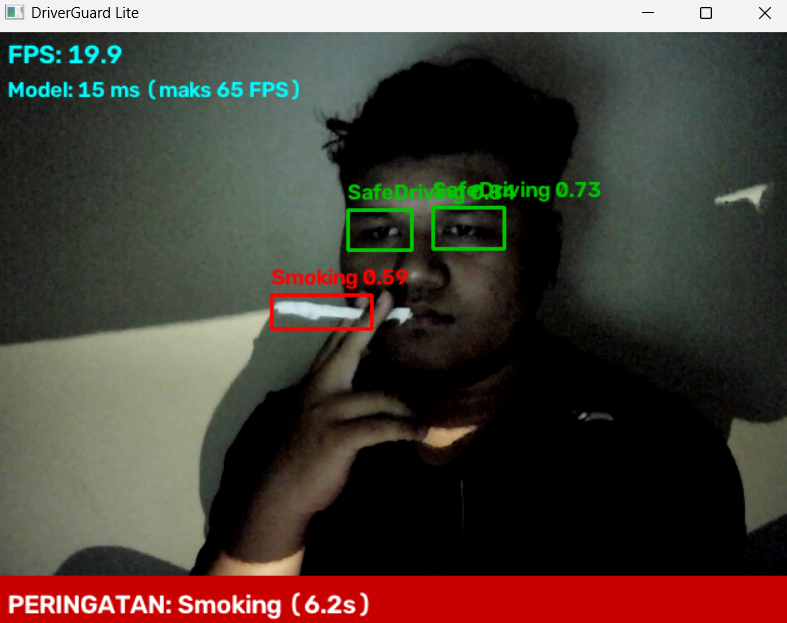 |
| **Drinking** 0.62 | **Smoking** (pen) 0.59 |

FPS stayed at ~20 in dim light. The model is robust to dim lighting; object-shaped classes (bottle, pen) lose the most confidence. Total darkness and IR cameras have not been tested.

## Key findings
1. **Viewpoint / domain shift.** `Distracted` reaches 0.975 mAP50 on the test set, yet head turns from a frontal camera are not detected. The test set comes from the same distribution as the training data, so it does not measure camera-angle shift. `Distracted` was likely learned from cabin angles that show the body/hands, and since `SafeDriving`/`Drowsy` are eye-based, a turned head with open eyes is still read as `SafeDriving`.
2. **`PhoneUse` false positives** on hand-held objects near the face (a bottle) point to a need for hard negatives.
3. **Duration-based logic** suppresses false alarms from blinks and momentary detections.
4. **INT8 quantization** reduced size ~3x with no accuracy drop.

## Limitations
- Real-world tests were done by one person with one frontal webcam; they are qualitative, not a benchmark.
- Head-turn / body-movement detection from a side-low (dashboard-style) camera: not yet tested.
- A 2-minute false-alarm test while sitting normally: not yet tested.
- Glasses and sunglasses: not yet tested.
- Total darkness / IR: not yet tested.
- `Drowsy` recall on the test set is 0.789 (< 0.80 target).
- The alarm beep is Windows-only.

## Future work
- Fine-tune with data from the target (dashboard) camera angle, plus hard negatives (bottles, wallets, remotes) for `PhoneUse`.
- Add a head-pose rule (e.g. MediaPipe Face Mesh) to detect head turns without extra training.
- Use an IR camera for night driving.
- Deploy to an edge device (e.g. Intel NUC / NVIDIA Jetson) with event-based triggers.
- Collect more `Drowsy` data to push recall above 0.80.

## Getting started

```bash
git clone https://github.com/dmascp/driverguard-lite.git
cd driverguard-lite
pip install -r requirements.txt

# OpenVINO INT8 model (recommended)
python src/webcam_app.py --camera 1 --model models/best_int8_openvino_model

# PyTorch model, default camera
python src/webcam_app.py
```

Options: `--model`, `--camera` (default 0), `--conf` (default 0.5), `--alarm-seconds` (default 2). Press `q` in the video window to quit. Events are saved to `logs/events.csv` (git-ignored).

## Repository structure

```
driverguard-lite/
├── docs/images/            # webcam test screenshots
├── models/
│   ├── best.pt
│   └── best_int8_openvino_model/
├── notebooks/DriverGuard_Lite_Training.ipynb
├── results/                # training curves, confusion matrices
├── src/webcam_app.py
├── .gitignore
├── requirements.txt
└── README.md
```

## Acknowledgements
Dataset: [Driver Monitoring System](https://universe.roboflow.com/driver-monitoring-system-woxvc/driver-monitoring-system-v0mei/dataset/11) by `driver-monitoring-system-woxvc` on Roboflow Universe, licensed under [CC BY 4.0](https://creativecommons.org/licenses/by/4.0/). Model: [Ultralytics YOLO11](https://github.com/ultralytics/ultralytics). Inference optimization: [OpenVINO](https://github.com/openvinotoolkit/openvino) and NNCF.

## Author
**Demas Chandra Permana**: [GitHub](https://github.com/dmascp) · [LinkedIn](https://linkedin.com/in/demas-chandra-permana-444917368)
